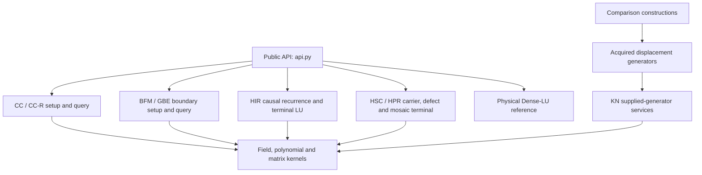

# Code guide: layers, representations and execution paths

Use [SOLVERS](SOLVERS.md) to choose a method, and [EXAMPLES](../examples/README.md)
to run it. This guide is for reading or modifying the implementation. Its final
module index covers every substantive Python module under `_internal/`.

## Read by layer

| Layer | Responsibility | Main locations |
|---|---|---|
| User contract | Validate lag shapes, choose an exact backend, return a consistent prepared interface | `api.py`, `matrices.py` |
| Algorithm setup | Construct the state for a particular matrix; pay all acquisition work | `cc_prepared.py`, `boundary_front/api.py`, `hir_prepared.py`, `halfstrip_core/solver.py`, `halfstrip_core/reuse.py` |
| Queries | Apply the retained state to new RHS vectors and literal transposes | The prepared classes in those modules; `boundary_front/query.py`; `halfstrip/recurrence.py` |
| Representations | Lag tables, local dense fronts, series dictionaries, correction/displacement generators | Explained below; these objects have different shapes and purposes |
| Basic operations | Field arithmetic, polynomial products, matrix products, elimination, PM-Basis | `banded_bttb/field.py`, `halfstrip_core/exact.py`, `halfstrip_core/poly.py`, `halfstrip/allfield_poly.py`, `halfstrip_core/uniform_terminal.py` |
| Compiled kernels | Exact FLINT products and solve kernels selected within a scope | `cc_kernels.py`, `extension_kernels.py`, `halfstrip_core/flint_backend.py` |
| Trials | Alternative physical front ends, generator terminals and multiplication controls | `dedicated_banded_arithmetic.py`, `full_halfstrip.py`, `hb_physical_solver.py`, `kn_*`; [outcomes](../REJECTED_ROUTES.md) |
| Measurements | Fixed inputs, paid timing boundaries, exact checks and table rendering | `reproduce/`, independently of solver setup/query logic |

The low-level files are organized around mathematical components. A component
can be shared by several algorithms. Reading a file named for a terminal does
not mean the caller is executing its entire solver.

The `hb_*` files refer to the paper's supplied-root **HB class**, whose
field-size, root and bandwidth inequalities are stated under CC in
[SOLVERS](SOLVERS.md#cc-and-cc-r-wrap-diagonalize-correct). They implement the
Structured-CC comparison, distinct from the main `cc_prepared.py` implementation.

## Setup and query entry points

All paths in this table are under `bttb_solvers/_internal/`. Public wrappers are
in [api.py](../bttb_solvers/api.py).

| Public call | Actual setup entry | Retained object / query entry |
|---|---|---|
| `prepare_cc`, `prepare_cc_r` | `cc_prepared.py::CirculantCorrectionPrepared.__init__` | `CirculantCorrectionPrepared.query`; CC-R additionally stores `ToeplitzInverseFactors` |
| `prepare_cc_e`, `prepare_cc_e_r` | Same setup with supplied `FqFieldNative`, extension kernel scope | Same queries, followed by base-field descent |
| `prepare_bfm` | `boundary_front/api.py::BoundaryFrontPrepared`, then `_Core` | `boundary_front/query.py::solve_batched`; raw Toeplitz transpose queries reuse this core with coordinate reversal |
| `prepare_gbe` | `guarded_boundary/unified.py::UnifiedPrepared._prepare_rootfree` | Its guarded query path and `operations.py` / `banded.py` prepared states |
| `prepare_hir` | `hir_prepared.py::prepare_hir`, then `halfstrip/solver.py::HalfStripSolver.prepare` | `HalfStripSolver.solve`, `solve_transpose`, `det` |
| `solve_hsc` | `halfstrip_core/reuse.py::oneshot_solve`, then `halfstrip_core/solver.py::solve` | One result; repeats the construction per call |
| `solve_hsc_q0` | `hsc_solver.py::solve_hsc`, with `precision_mode="q0_L"` | One result; guarded reduced precision and no prepared-query reuse |
| `prepare_hpr` | `halfstrip_core/reuse.py::FailedH0Reuse._establish` and `_Core` | `_Core`'s LU, division or appended query path, owned by `FailedH0Reuse` |
| `prepare_dense_lu` | `dense_lu.py::NativeLU.from_problem`, then `factorize` | `NativeLU.solve`, `determinant`, `close` |
| `solve_dedicated` | `dedicated_banded_arithmetic.py`, then `banded_physical_solver.py` | A complete one-pair result; its raw generators are acquired inside this call |

`PreparedSolver` in `api.py` supplies the uniform public methods `solve`,
`solve_transpose`, `solve_many`, `determinant` where exposed, and `close`.
It re-enters the selected kernel scope around queries. Kernel rebinding is
process-global: these interfaces and the reproduction runner are used serially.

## Representations: which matrix is actually stored?

| Representation | Shape / convention | Constructed in | Used for |
|---|---|---|---|
| Raw banded or half-strip lags | Outer-lag rows, each with `2*n-1` scalar inner lags | Caller; public validation; `reproduce/fixtures.py` | Original input and independent residual checks |
| Physical dense matrix | `N` by `N`, `N=n*n`; therefore `n**4` entries | `dense_lu.py::NativeLU.from_problem`; `matrices.py::dense_matrix` | Dense references and small independent checks |
| Dense frequency block | `n` by `n` | `banded_bttb/toeplitz.py` or the FLINT CC kernel replacement | Inversion/solving of one CC frequency block |
| Four-vector Toeplitz inverse | Four length-`n` vectors, applied by convolution | `cc_prepared.py::ToeplitzInverseFactors` | CC-R frequency queries; distinct from a dense frequency inverse |
| Woodbury correction | Reduced square correction matrix plus boundary/repair maps | `banded_bttb/woodbury.py` | CC/CC-R wrap and symbol-repair correction |
| Boundary front | Local dense blocks and retained boundary maps at interval types | `boundary_front/homogeneous.py`; `guarded_boundary/banded.py` | BFM/GBE hierarchical elimination, without a physical dense inverse |
| Scalar polynomial | Low-degree-first coefficient list | `banded_bttb/polynomial.py`, `kn_polynomial.py`, multipliers | Polynomial arithmetic and convolution |
| Sparse Laurent-polynomial matrix | Matrix entries are degree-to-coefficient dictionaries | `halfstrip_core/exact.py`, `poly.py` | Carrier, inverse-series and joint-defect calculations |
| Truncated series arrays | Coefficients stored in fixed windows / array views | `joint_arrays.py`, `source_histories.py`, `q0_source.py` | Explicit coefficient acquisition and reconstruction experiments |
| Mosaic terminal | Chain lengths and coefficient access, with approximant-basis data | `halfstrip_core/mosaic.py` and `packed_terminal` | HSC/HPR terminal determinant, affine solve and query preparation |
| HIR terminal | Dense impulse-tail matrix | `halfstrip/solver.py`, `halfstrip_structured_terminal.py` | Match causal solutions to the terminal boundary conditions |
| Displacement generators | Two `d` by `beta` matrices `g,h`, representing a structured `d` by `d` system | `wide_raw_generator.py`, `weighted_correction.py` | Dedicated trial terminals; acquired from raw lags before solving |

For the Stein form used by `kn_services.py::solve_stein`, the generators satisfy
`M - Z*M*transpose(Z) = g*transpose(h)`, where `Z` is the nilpotent down-shift.
The generators describe `M`; they are not its inverse or a precomputed solution.
`_prepare_paid_dense` explicitly reconstructs a dense base when the terminal
order is no larger than the generator width and charges that work.

A “dense backend” can mean a frequency block, local front, terminal base or full
physical matrix. Check the row above before interpreting a timing or memory
number. Only the physical dense reference always allocates the full `N`-square
matrix. Other algorithms can still have large terminal/front storage.

## Basic operations and field interfaces

The code has two small field protocols, with adapters at their boundaries:

- The CC/HIR coordinate interface uses `zero()`, `one()`, `add`, `sub`, `mul`,
  `inv`, powers, equality and field size. It lives in `banded_bttb/field.py`;
  `extension_field.py` supplies native extension elements.
- Native polynomial/front-end code uses the eight guarded operations `zero`,
  `one`, `add`, `sub`, `neg`, `mul`, `inv`, `is_zero`. See
  `halfstrip_core/exact.py`, `boundary_front/fields.py`, `native_field_view.py`
  and `guarded_boundary/fields.py`. `LeanAttrField` adapts the callable-zero
  protocol to GBE's attribute-style protocol.

`halfstrip_core/exact.py` also contains elementary elimination and sparse
polynomial-matrix helpers. `halfstrip_core/poly.py` handles longer products,
series inversion and structural counters. `fast_scalar.py` owns scalar-polynomial
operations used by acquisition code. `label_algebra.py` and
`halfstrip_core/field_setup.py` construct/restrict working algebras when needed;
a failed guard restarts the owning construction from the original coefficients.

`backend="python"` uses explicit exact reference operations. `backend="flint"`
selects scoped compiled kernels. `flint_backend.py` is a dispatcher for exact
products/dots/updates; it does not choose a whole solver. Native work is not
reported as an invented scalar-operation count.

## Dense kernels and Strassen

There are **two explicit recursion implementations**, because their operand
representations differ:

1. [`boundary_front/kernel.py`](../bttb_solvers/_internal/boundary_front/kernel.py)
   handles BFM's rectangular local-front products. `_strassen_product` pads and
   blocks them; `_flint_square` performs recursive seven-product square kernels
   for the native prime-field case. Small dimensions use classical leaves.
2. [`halfstrip_core/uniform_terminal.py`](../bttb_solvers/_internal/halfstrip_core/uniform_terminal.py)
   implements constant and polynomial matrix products. `_square` is the recursive
   Strassen kernel, `_rectangular` is its rectangular wrapper, and
   `matrix_product` / `polynomial_matrix_product` are its callers' entry points.
   The dedicated Strassen construction uses these operations throughout its
   selected dense scope.

[`halfstrip_core/dense_backend.py`](../bttb_solvers/_internal/halfstrip_core/dense_backend.py)
**selects and records** a classical/Strassen scope; it is not the recursion
itself. A context includes the leaf size and records recursive nodes, leaves and
compiled products. The paper uses leaf 16 for BFM-Strassen and leaf 8 for the
dedicated Strassen control. [Strassen 1969](../REFERENCES.md#strassen-1969) is the
algorithmic reference. FLINT's own internal product selection is separate.

To experiment, run `examples/strassen.py` and inspect the emitted ledger. The
unit tests require nonzero recursive-node counts as well as exact answers.

## CK and KN: what these prefixes mean

**CK = Cantor–Kaltofen**, a polynomial-multiplication construction. It is not a
linear-system solver. `halfstrip/ck_poly.py::make_multiplier` returns a reusable
convolution callable over a supplied field. It uses recursive cyclotomic
quotient products; radix two is replaced by radix three in characteristic two.
Its fixed scalar leaf is 64 coefficients. `halfstrip/allfield_poly.py` is the
separately specified uniform synthetic-transform multiplier. It permits a bounded
native accelerator while retaining its generic recursion. The front-end and
terminal multiplier choices are joined in `allfield_convolve.py` and
`allfield_solver.py`. Reference: [Cantor–Kaltofen 1991](../REFERENCES.md#cantor-and-kaltofen-1991).

**KN = Khichane–Neiger**, the supplied-displacement-generator construction.
`kn_services.py::Services.solve_stein` is its service boundary. It has a paid dense
base and three larger-instance phases: vector approximation, generator/RHS
rational-vector reconstruction, and simultaneous approximation. The surrounding
physical solver must first acquire its generators and later reconstruct its
physical answers.

| File | Concrete responsibility | Source / context |
|---|---|---|
| `kn_polynomial.py` | Scalar-polynomial and polynomial-matrix utility methods and degree-budget products | Shared foundation for the following classes |
| `kn_kernel.py` | Polynomial kernel/degree-budget operations, including `rational_vector_xd` | Structured generator reconstruction ingredients |
| `kn_approximant.py` | Canonical/known-degree approximant bases, `vector_mpade`, `recursive_shpade`, simultaneous approximation | Jeannerod–Neiger–Villard; Rosenkilde–Storjohann |
| `kn_krylov.py` | Small-order canonical leaf via a nilpotent/striped-Krylov construction | Jeannerod–Neiger–Schost–Villard |
| `kn_services.py` | Acquired-generator solve/nullspace services, paid dense bases and the three-phase orchestration | Khichane–Neiger preprint construction |
| `kn_modular_vector.py` | Polynomial-vector solve modulo a polynomial, including `z**n-c` | Used by carrier/projection computations; not a separate physical solver |

The [references](../REFERENCES.md) give full titles, versions and DOI/arXiv links.
These modules are reusable implementation components, even when an end-to-end
trial using them is not competitive. Their names do not claim that the paper's
full fast-exponent equality-test trees are implemented.

## Where to make a change

| Experiment | Edit / call | Check afterwards |
|---|---|---|
| New matrix entries or RHS | Use the lag convention in `matrices.py`; change `reproduce/fixtures.py` only for a new experiment | Independent `action` residuals; retain the fixed paper fixtures for reproduction |
| Reuse vs setup cost | Public `prepare_*` followed by several queries; HSC remains one-shot | Count setup once and check every RHS |
| Classical vs Strassen | `prepare_bfm(product=..., strassen_leaf=...)`; `solve_dedicated(product=..., strassen_leaf=...)` | Exact answers and nonzero recursion ledger for an appropriately large test |
| Four-vector vs direct CC query | Compare `prepare_cc` and `prepare_cc_r` on the same lags/root | Include the extra factor preparation; check both transpose directions |
| HPR terminal method | `prepare_hpr(..., terminal_query="lu"/"division"/"appended")` | Record the method, retain certificate failures and verify exact residuals |
| Scalar polynomial multiplier | `halfstrip/allfield_convolve.py::select_multiplier` or the explicit multiplier variants in the runner | Compare with schoolbook products, including characteristic two and non-power-of-two lengths |
| Representation acquisition | `narrow_raw_frontend.py`, `wide_raw_generator.py`, `weighted_*` | Charge acquisition from raw lags and verify generator identities before terminal solves |
| Native matrix binding | `dense_lu.py` | ABI/version checks, permutation sign, literal transpose and one-factorization tests |

## Complete module index

Roles: **Main** is a main solver implementation; **Shared** is an algebra/representation
component; **Trial** is a retained comparison or alternate construction. **Mixed** files
also expose helpers used by main routes. The role is about this package, not a proof status.
Empty package `__init__.py` files provide namespaces only.

### Main CC setup and queries

| File | Role | Responsibility / reading entry |
|---|---|---|
| [cc_kernels.py](../bttb_solvers/_internal/cc_kernels.py) | Shared | Scoped FLINT replacements for CC Toeplitz, transform, repair and correction kernels; restores the original functions on scope exit. Start at `kernels`. |
| [cc_prepared.py](../bttb_solvers/_internal/cc_prepared.py) | Main | Construct the repaired block-circulant/Woodbury preparation; query it directly or with retained four-vector Toeplitz inverse factors. Start at `CirculantCorrectionPrepared; ToeplitzInverseFactors`. |
| [extension_field.py](../bttb_solvers/_internal/extension_field.py) | Shared | Native GF(p**d) field and polynomial contexts, coercions and guarded inverses for the supplied-extension CC adapters. Start at `FqField; FqFieldNative`. |
| [extension_kernels.py](../bttb_solvers/_internal/extension_kernels.py) | Shared | Scoped extension-field matrix and polynomial kernels, including regular-representation matrix arithmetic. Start at `kernels`. |

### Physical dense baseline

| File | Role | Responsibility / reading entry |
|---|---|---|
| [dense_lu.py](../bttb_solvers/_internal/dense_lu.py) | Main | Owned native FLINT matrices, checked ABI binding, one physical LU, batched literal-transpose/forward solves and determinant extraction. Start at `NativeAPI; OwnedMat; NativeLU`. |

### Main HIR construction

| File | Role | Responsibility / reading entry |
|---|---|---|
| [hir_prepared.py](../bttb_solvers/_internal/hir_prepared.py) | Main | Configure the HIR leading-block recurrence, response layout and terminal solver; the public wrapper selects n impulses and a dense terminal. Start at `prepare_hir; solve_hir`. |

### Alternative HIR terminals

| File | Role | Responsibility / reading entry |
|---|---|---|
| [halfstrip_structured_terminal.py](../bttb_solvers/_internal/halfstrip_structured_terminal.py) | Trial/shared | Alternative terminal representations and causal solves for recurrence-based half-strips; these are separate from the public HIR dense-terminal default. Start at `StructuredTerminal; DenseImpulseTerminal`. |

### Main HSC and HPR construction

| File | Role | Responsibility / reading entry |
|---|---|---|
| [hsc_solver.py](../bttb_solvers/_internal/hsc_solver.py) | Main | Raw-lag classical source adapter with precision selection and guarded algebra restart; used by the public HSC-q0 route. Public HSC uses oneshot_solve in halfstrip_core/reuse.py. Start at `solve_hsc; _attempt`. |

### Field setup and common representation tools

| File | Role | Responsibility / reading entry |
|---|---|---|
| [constant_profile.py](../bttb_solvers/_internal/constant_profile.py) | Shared | Exact constant-matrix row/rank-profile selection and kernel data; used by structured acquisition code. Start at `rank_profile_kernel; row_rank_profile`. |
| [fast_scalar.py](../bttb_solvers/_internal/fast_scalar.py) | Shared | Fast scalar-polynomial arithmetic used by label acquisition and physical front ends; reports nonunits to the owning restart loop. Start at `FastScalar; PolynomialNonUnit`. |
| [label_algebra.py](../bttb_solvers/_internal/label_algebra.py) | Shared | Acquire nonzero evaluation labels and an owning coefficient algebra; guard restrictions and descent remain attached to that construction. Start at `setup_label_algebra; LabelAlgebraContext`. |
| [native_field_view.py](../bttb_solvers/_internal/native_field_view.py) | Shared | Adapt explicit coordinate fields to the guarded native-operation interface used by source/generator acquisition. Start at `NativeBaseFieldView`. |
| [owned_label_algebra.py](../bttb_solvers/_internal/owned_label_algebra.py) | Shared | Own scalar embeddings, guarded operations, algebra restrictions and descent for label-based source constructions. Start at `OwnedLabelAlgebra`. |

### Displacement construction trials

| File | Role | Responsibility / reading entry |
|---|---|---|
| [banded_column_basis.py](../bttb_solvers/_internal/banded_column_basis.py) | Trial/shared | Polynomial column/image basis construction for the dedicated front end, with degree and reconstruction bookkeeping. Start at `ColumnBasis`. |
| [banded_frontend_rank.py](../bttb_solvers/_internal/banded_frontend_rank.py) | Trial/shared | Guarded maximum-minor and coordinate-completion operations for polynomial-symbol rank acquisition. Start at `certified_maximum_minor; narrow_raw_minor`. |
| [banded_general_approximant.py](../bttb_solvers/_internal/banded_general_approximant.py) | Trial/shared | General-order canonical approximant operations used by the raw polynomial front end. Start at `GeneralApproximant`. |
| [banded_physical_solver.py](../bttb_solvers/_internal/banded_physical_solver.py) | Trial | Dispatch the dedicated raw-lag solve to narrow or wide physical acquisition, paying front end, generator acquisition and both queries. Start at `solve_banded`. |
| [banded_polynomial_determinant.py](../bttb_solvers/_internal/banded_polynomial_determinant.py) | Trial/shared | Polynomial-symbol determinant acquisition from a certified maximum minor; signals the nonsingular determinant branch. Start at `determinant_from_maximum_minor; NonsingularDeterminant`. |
| [cauchy_transforms.py](../bttb_solvers/_internal/cauchy_transforms.py) | Trial/shared | Multipoint/Cauchy transform catalogs, reciprocal products and evaluation maps for generator acquisition. Start at `CauchyCatalog`. |
| [compact_cauchy.py](../bttb_solvers/_internal/compact_cauchy.py) | Trial/shared | Compact Cauchy transform operations used by the grouped source/chart constructions. Start at `CompactCauchy`. |
| [dedicated_banded_arithmetic.py](../bttb_solvers/_internal/dedicated_banded_arithmetic.py) | Trial | Select classical or explicit Strassen dense operations around the complete dedicated physical solve; the classical many-pair service has a separate reuse contract. Start at `solve_dedicated_banded; solve_dedicated_banded_many`. |
| [generator_compression.py](../bttb_solvers/_internal/generator_compression.py) | Trial/shared | Two-pass exact rank-factor compression of acquired displacement generators; preserves the represented matrix and records paid work. Start at `compress_generators; CompressedGenerators`. |
| [grouped_chart.py](../bttb_solvers/_internal/grouped_chart.py) | Trial/shared | Search and certify grouped/cyclic chart data consumed by narrow front-end acquisition. Start at `prepare_grouped_chart; select_cyclic_chart`. |
| [mixed_cross.py](../bttb_solvers/_internal/mixed_cross.py) | Trial/shared | Represent mixed upper/lower boundary crosses and physical displacement actions without an unconditional physical dense matrix. Start at `MixedUpperCross; MixedLowerCross; PhysicalDisplacement`. |
| [narrow_physical_solver.py](../bttb_solvers/_internal/narrow_physical_solver.py) | Trial | Narrow-band acquisition/restart, weighted carrier/correction construction, generator terminal and physical answer reconstruction. Start at `solve_narrow; solve_narrow_many`. |
| [narrow_raw_frontend.py](../bttb_solvers/_internal/narrow_raw_frontend.py) | Trial | Acquire a narrow raw polynomial symbol, chart and repaired front-end state; restrictions replay from the cached original lags. Start at `RawNarrowFrontend; prepare_narrow_frontend`. |
| [rectangular_cauchy.py](../bttb_solvers/_internal/rectangular_cauchy.py) | Trial/shared | Rectangular Cauchy subviews and products over selected row/column labels. Start at `RectangularCauchy`. |
| [spatial_transforms.py](../bttb_solvers/_internal/spatial_transforms.py) | Trial/shared | Spatial evaluation/correlation transforms used to move between raw Toeplitz data and carrier/generator coordinates. Start at `SpatialTransform; row_product; correlation`. |
| [toeplitz_repair.py](../bttb_solvers/_internal/toeplitz_repair.py) | Trial/shared | Repair a singular Toeplitz matrix-valued symbol within the acquired coefficient context; return the explicit low-rank correction. Start at `repair_toeplitz_symbol`. |
| [weighted_carrier.py](../bttb_solvers/_internal/weighted_carrier.py) | Trial/shared | Retain weighted carrier actions over the acquired chart; used before projected correction generators are constructed. Start at `WeightedRingCarrier; acquire_weighted_carrier`. |
| [weighted_correction.py](../bttb_solvers/_internal/weighted_correction.py) | Trial/shared | Assemble and expose the weighted wrap/repair correction and its generator-compatible maps. Start at `WeightedCorrection; acquire_weighted_correction`. |
| [weighted_projections.py](../bttb_solvers/_internal/weighted_projections.py) | Trial/shared | Build forward and transpose carrier projections and their physical actions for the correction construction. Start at `acquire_weighted_projections; ProjectedCarrier`. |
| [wide_physical_solver.py](../bttb_solvers/_internal/wide_physical_solver.py) | Trial | Acquire wide-band Stein generators, optionally compress them, and solve the resulting physical service through supplied-generator algebra. Start at `WidePhysicalSolver; solve_wide`. |
| [wide_raw_generator.py](../bttb_solvers/_internal/wide_raw_generator.py) | Trial | Construct wide-band physical displacement generators directly from original Toeplitz lags and their reversed orientation. Start at `WideGenerator; acquire`. |

### Structured CC comparison

| File | Role | Responsibility / reading entry |
|---|---|---|
| [hb_frontend.py](../bttb_solvers/_internal/hb_frontend.py) | Trial | Acquire the supplied-root structured CC front end, symbol rank/determinant, valid parameter and coordinate context. This is distinct from cc_prepared.py. Start at `prepare_hb_frontend`. |
| [hb_physical_solver.py](../bttb_solvers/_internal/hb_physical_solver.py) | Trial | Compose the structured supplied-root carrier, projected correction and terminal into a one-pair comparison, with an optional prepared classical inner base. Start at `solve_hb; prepare_hb`. |
| [hb_prepared_dense.py](../bttb_solvers/_internal/hb_prepared_dense.py) | Trial/shared | Retain the dense inner PLU base for the structured CC comparison. This is not CC-R four-vector frequency preparation. Start at `HBPreparedDense`. |

### Structured half-strip comparison

| File | Role | Responsibility / reading entry |
|---|---|---|
| [full_halfstrip.py](../bttb_solvers/_internal/full_halfstrip.py) | Mixed | Trial structured half-strip solve with explicit source histories and whole-attempt restart/descent; its input/restriction helpers are also shared by HSC-q0. Start at `solve_full; _input; _retained_factor`. |
| [full_source_readout.py](../bttb_solvers/_internal/full_source_readout.py) | Trial | Read source coefficients, form the terminal problem and recover a physical solution in the structured half-strip comparison. Start at `FullSource; solve_prepared`. |
| [initial_carrier.py](../bttb_solvers/_internal/initial_carrier.py) | Trial | Acquire the initial structured carrier for the explicit-history half-strip comparison. Main HSC/HPR use halfstrip_core/carrier.py instead. Start at `InitialCarrier`. |
| [initial_joint.py](../bttb_solvers/_internal/initial_joint.py) | Trial | Bind a structured carrier to the explicit joint state and its coefficient/window operations. Start at `InitialJoint`. |
| [joint_arrays.py](../bttb_solvers/_internal/joint_arrays.py) | Trial/shared | Fixed-window scalar series operations, polynomial factor trimming and permutation signs for the array-based joint representation. Start at `SeriesOps; trim_factor`. |
| [joint_blocks.py](../bttb_solvers/_internal/joint_blocks.py) | Trial/shared | Materialize requested physical/principal blocks from the explicit joint state when the construction pays for them. Start at `materialize_physical; whole_principal_block`. |
| [joint_compiler.py](../bttb_solvers/_internal/joint_compiler.py) | Trial/shared | Compile the explicit-history joint-defect representation. Main HSC/HPR use halfstrip_core/joint.py instead. Start at `compile_joint`. |
| [joint_state.py](../bttb_solvers/_internal/joint_state.py) | Trial/shared | Own the evolving array-based joint-defect state used by the structured half-strip construction. Start at `JointState`. |
| [joint_valuation.py](../bttb_solvers/_internal/joint_valuation.py) | Trial/shared | Select active valuations and extract common factors/column quotients during joint compilation. Start at `minimum_active; column_quotient; extract_common`. |
| [q0_source.py](../bttb_solvers/_internal/q0_source.py) | Trial/shared | Raw Toeplitz coefficient and spatial-convolution access for explicit source acquisition. The public HSC-q0 precision adapter lives in hsc_solver.py. Start at `SpatialConvolution; RawToeplitzLags`. |
| [source_histories.py](../bttb_solvers/_internal/source_histories.py) | Trial/shared | Retain principal and paired source-history windows used by explicit structured readout. Start at `PrincipalHistory; PairedHistories`. |

### KN supplied-generator algebra

| File | Role | Responsibility / reading entry |
|---|---|---|
| [kn_approximant.py](../bttb_solvers/_internal/kn_approximant.py) | Trial/shared | Canonical/known-degree approximant, vector approximation and simultaneous Hermite-Pade routines for the supplied-generator construction. Start at `Approximant`. |
| [kn_kernel.py](../bttb_solvers/_internal/kn_kernel.py) | Trial/shared | Polynomial kernel and degree-budget constructions, including rational_vector_xd for generator/RHS reconstruction. Start at `Kernel`. |
| [kn_krylov.py](../bttb_solvers/_internal/kn_krylov.py) | Trial/shared | Small-order canonical approximant leaf based on exact nilpotent/striped Krylov actions and row-rank profiles. Start at `canonical_leaf; row_rank_profile`. |
| [kn_modular_vector.py](../bttb_solvers/_internal/kn_modular_vector.py) | Trial/shared | Solve a polynomial-matrix/vector problem modulo a supplied polynomial or z**n-c for carrier and projection operations. Start at `ModularVector.solve_mod`. |
| [kn_polynomial.py](../bttb_solvers/_internal/kn_polynomial.py) | Shared | Khichane-Neiger-related scalar polynomial, matrix and degree-budget utilities, reused by both front-end and terminal components. Start at `Polynomial`. |
| [kn_services.py](../bttb_solvers/_internal/kn_services.py) | Trial | Khichane-Neiger-style supplied-generator solve/nullspace service: paid dense base and three approximation/reconstruction phases. Raw physical acquisition is external. Start at `Services.solve_stein; Services.solve_scalar`. |

### CC Toeplitz, symbol and correction primitives

| File | Role | Responsibility / reading entry |
|---|---|---|
| [banded_bttb/circulant.py](../bttb_solvers/_internal/banded_bttb/circulant.py) | Shared | Frequency symbols, direct/radix-two transforms, inverse-corner accumulation and circulant inverse application. |
| [banded_bttb/counter.py](../bttb_solvers/_internal/banded_bttb/counter.py) | Shared | Reference-operation and stage counters; compiled kernels do not invent equivalent scalar counts. |
| [banded_bttb/errors.py](../bttb_solvers/_internal/banded_bttb/errors.py) | Shared | Typed CC field, root, parameter, repair and singularity refusals. |
| [banded_bttb/field.py](../bttb_solvers/_internal/banded_bttb/field.py) | Shared | Explicit prime/extension coordinate fields, guarded arithmetic, size/order and supplied-root helpers. |
| [banded_bttb/polynomial.py](../bttb_solvers/_internal/banded_bttb/polynomial.py) | Shared | Exact scalar-polynomial utilities, Euclidean operations, interpolation and product trees. |
| [banded_bttb/repair.py](../bttb_solvers/_internal/banded_bttb/repair.py) | Shared | Normal-rank tests and low-rank Toeplitz symbol repair for CC. |
| [banded_bttb/symbol.py](../bttb_solvers/_internal/banded_bttb/symbol.py) | Shared | Raw banded symbol representation, frequency evaluation, determinant polynomial and valid-parameter search. |
| [banded_bttb/toeplitz.py](../bttb_solvers/_internal/banded_bttb/toeplitz.py) | Shared | One-level Toeplitz solve, inverse, determinant and rank primitives plus elementary matrix helpers. |
| [banded_bttb/woodbury.py](../bttb_solvers/_internal/banded_bttb/woodbury.py) | Shared | Wrap/repair maps, reduced correction matrix construction, factorization and forward/transpose correction. |

### BFM local-front implementation

| File | Role | Responsibility / reading entry |
|---|---|---|
| [boundary_front/api.py](../bttb_solvers/_internal/boundary_front/api.py) | Main/shared | BFM preparation, prepared queries and statistics. Raw Toeplitz transpose queries reuse the core; arbitrary dense blocks use a lazy second core. |
| [boundary_front/fields.py](../bttb_solvers/_internal/boundary_front/fields.py) | Main/shared | Native eight-operation fields and adapters, including LeanAttrField for the GBE comparator. |
| [boundary_front/homogeneous.py](../bttb_solvers/_internal/boundary_front/homogeneous.py) | Main/shared | Eliminate interiors and merge homogeneous boundary fronts by shared interval type. |
| [boundary_front/incidence.py](../bttb_solvers/_internal/boundary_front/incidence.py) | Main/shared | Describe how retained/seam/exterior rows enter a front merge. |
| [boundary_front/kernel.py](../bttb_solvers/_internal/boundary_front/kernel.py) | Main/shared | Local matrix products, classical/Strassen selection, rectangular blocking and native recursive seven-product squares. |
| [boundary_front/query.py](../bttb_solvers/_internal/boundary_front/query.py) | Main/shared | Batched upward and downward RHS propagation over the prepared interval schedule. |
| [boundary_front/residual.py](../bttb_solvers/_internal/boundary_front/residual.py) | Main/shared | Independent physical residual actions selected by the prepared BFM interface. |
| [boundary_front/schedule.py](../bttb_solvers/_internal/boundary_front/schedule.py) | Main/shared | Balanced occurrence tree and batches of equal interval types. |
| [boundary_front/selection.py](../bttb_solvers/_internal/boundary_front/selection.py) | Main/shared | Guarded row-profile selection and inverse maps for normalized boundary equations. |

### GBE boundary comparator

| File | Role | Responsibility / reading entry |
|---|---|---|
| [guarded_boundary/banded.py](../bttb_solvers/_internal/guarded_boundary/banded.py) | Main/shared | Retained-boundary elimination and queries for general outer half-bandwidth. |
| [guarded_boundary/boundary.py](../bttb_solvers/_internal/guarded_boundary/boundary.py) | Main/shared | Small exact dense/front operations and guarded normalization. |
| [guarded_boundary/fields.py](../bttb_solvers/_internal/guarded_boundary/fields.py) | Main/shared | Attribute-style exact fields expected by the boundary recurrence. |
| [guarded_boundary/operations.py](../bttb_solvers/_internal/guarded_boundary/operations.py) | Main/shared | Width-one repeated-block boundary preparation and query recurrence. |
| [guarded_boundary/unified.py](../bttb_solvers/_internal/guarded_boundary/unified.py) | Main/shared | Validate raw inputs, select width-one/general boundary preparation, retain transpose state and check query residuals. |

### HIR, shared multiplication and alternate terminal components

| File | Role | Responsibility / reading entry |
|---|---|---|
| [halfstrip/allfield_convolve.py](../bttb_solvers/_internal/halfstrip/allfield_convolve.py) | Shared | Select the uniform or Cantor-Kaltofen scalar multiplier for inverse-series and terminal controls. |
| [halfstrip/allfield_poly.py](../bttb_solvers/_internal/halfstrip/allfield_poly.py) | Shared | Uniform synthetic-transform polynomial multiplication with fixed leaves and a bounded native accelerator. |
| [halfstrip/allfield_solver.py](../bttb_solvers/_internal/halfstrip/allfield_solver.py) | Trial/shared | Uniform/CK inverse-series and approximant-terminal comparison; a separate route from public HSC and HIR. |
| [halfstrip/approximant.py](../bttb_solvers/_internal/halfstrip/approximant.py) | Shared | Reference PM-Basis, shifted-degree and polynomial-matrix operations used by mosaic terminals. |
| [halfstrip/block_approximant.py](../bttb_solvers/_internal/halfstrip/block_approximant.py) | Trial/shared | Block approximant terminal alternative for the recurrence construction. |
| [halfstrip/block_cauchy.py](../bttb_solvers/_internal/halfstrip/block_cauchy.py) | Trial/shared | Block-Cauchy representation supporting alternate structured recurrence terminals. |
| [halfstrip/block_levinson.py](../bttb_solvers/_internal/halfstrip/block_levinson.py) | Trial/shared | Block-Levinson terminal alternative with its own checked domain. |
| [halfstrip/ck_poly.py](../bttb_solvers/_internal/halfstrip/ck_poly.py) | Shared | Cantor-Kaltofen cyclotomic-quotient scalar multiplication alternative; fixed leaves and explicit recursion statistics. |
| [halfstrip/convolve.py](../bttb_solvers/_internal/halfstrip/convolve.py) | Shared | Schoolbook/NTT exact convolution selection for HIR recurrence and leading-block applications. |
| [halfstrip/counter.py](../bttb_solvers/_internal/halfstrip/counter.py) | Shared | HIR recurrence, convolution, terminal and structural-operation counters. |
| [halfstrip/dense.py](../bttb_solvers/_internal/halfstrip/dense.py) | Shared | Exact dense LU of the small recurrence terminal, separate from the full physical dense reference. |
| [halfstrip/errors.py](../bttb_solvers/_internal/halfstrip/errors.py) | Shared | Typed leading-block, transform, width and terminal failures. |
| [halfstrip/jacobi_series.py](../bttb_solvers/_internal/halfstrip/jacobi_series.py) | Shared | Jacobi/inverse-series source construction for the uniform/CK comparison routes. |
| [halfstrip/jacobi_solver.py](../bttb_solvers/_internal/halfstrip/jacobi_solver.py) | Trial/shared | Alternate Jacobi-series half-strip solver with a checked terminal-chart contract. |
| [halfstrip/leading.py](../bttb_solvers/_internal/halfstrip/leading.py) | Shared | Compact one-level Toeplitz inverse of the leading block and its convolution applications. |
| [halfstrip/recurrence.py](../bttb_solvers/_internal/halfstrip/recurrence.py) | Shared | Causal response generation and forcing propagation, including CDQ convolution. |
| [halfstrip/solver.py](../bttb_solvers/_internal/halfstrip/solver.py) | Shared | HIR response preparation, terminal construction, determinant and prepared physical solves. |
| [halfstrip/symbol.py](../bttb_solvers/_internal/halfstrip/symbol.py) | Shared | Raw half-strip lag storage and index/field conventions. |

### Main HSC and HPR series/mosaic implementation

| File | Role | Responsibility / reading entry |
|---|---|---|
| [halfstrip_core/carrier.py](../bttb_solvers/_internal/halfstrip_core/carrier.py) | Main/shared | Correct singular F0 by a controlled low-rank carrier and construct the required inverse-series data. |
| [halfstrip_core/dense_backend.py](../bttb_solvers/_internal/halfstrip_core/dense_backend.py) | Shared | Context-local classical/Strassen selection and ledgers; actual multiplication recursion is in uniform_terminal.py. |
| [halfstrip_core/exact.py](../bttb_solvers/_internal/halfstrip_core/exact.py) | Shared | Native guarded field operations, elementary elimination, scalar polynomials and sparse Laurent-polynomial matrix helpers. |
| [halfstrip_core/fast_linear.py](../bttb_solvers/_internal/halfstrip_core/fast_linear.py) | Shared | Fast local linear-algebra helpers used by carrier/defect calculations. |
| [halfstrip_core/field_setup.py](../bttb_solvers/_internal/halfstrip_core/field_setup.py) | Shared | Acquire/restrict an effective working algebra, embed original coefficients, supply labels and descend results. |
| [halfstrip_core/flint_backend.py](../bttb_solvers/_internal/halfstrip_core/flint_backend.py) | Shared | Context-local exact native polynomial, dot-product and update kernels; no whole-solver selection. |
| [halfstrip_core/joint.py](../bttb_solvers/_internal/halfstrip_core/joint.py) | Main/shared | Compile the small defect, degree shifts and W/B/G reconstruction dictionaries for main HSC/HPR. |
| [halfstrip_core/mosaic.py](../bttb_solvers/_internal/halfstrip_core/mosaic.py) | Main/shared | Build/check mosaic Toeplitz terminal approximant problems and expose determinant/affine reconstruction data. |
| [halfstrip_core/poly.py](../bttb_solvers/_internal/halfstrip_core/poly.py) | Shared | Sparse/dense polynomial-matrix products, coefficient windows and series inversion with exact scalar backends. |
| [halfstrip_core/reuse.py](../bttb_solvers/_internal/halfstrip_core/reuse.py) | Main/shared | HPR preparation, restart ownership and LU/division/appended queries; also HSC oneshot_solve and deterministic fixture helpers. |
| [halfstrip_core/solver.py](../bttb_solvers/_internal/halfstrip_core/solver.py) | Main/shared | Main HSC carrier-to-terminal orchestration, determinant scaling, physical reconstruction and working-algebra descent. |
| [halfstrip_core/uniform_terminal.py](../bttb_solvers/_internal/halfstrip_core/uniform_terminal.py) | Shared | Constant/polynomial matrix multiplication, explicit Strassen recursion, elimination leaves and recursive PM-Basis primitives. |
